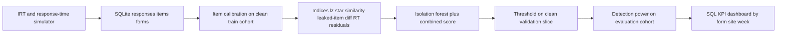
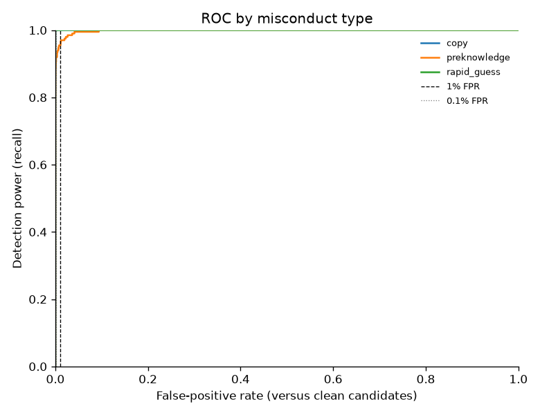
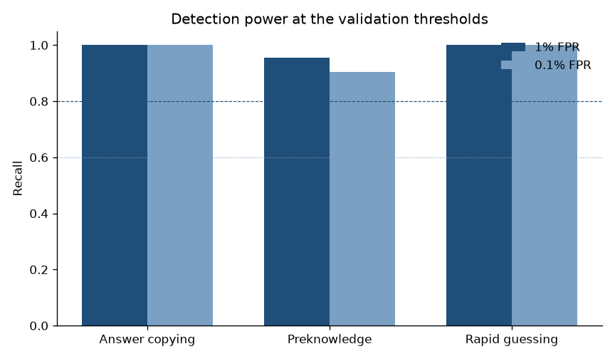
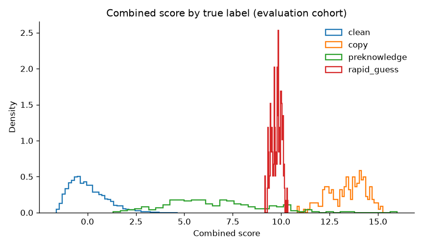
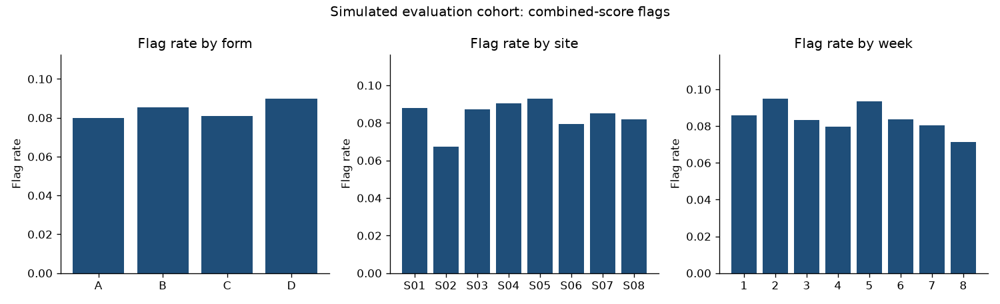

# Exam test-security forensics

This project simulates a certification exam with a two-parameter logistic response model and lognormal response times, injects known answer copying, item preknowledge, and rapid guessing, and scores each evaluation candidate with person-fit (lz*), answer similarity, a leaked-item residual, and a response-time residual. An isolation forest combines those indices. Flags use a threshold chosen on a clean validation slice so that the false-positive rate is about 1%. Item parameters, the forest, and the threshold are fit without the evaluation cohort. All candidates are synthetic.

## Setup

```
python -m venv .venv
.venv\Scripts\pip install -r requirements.txt
```

Python 3.11 or 3.12. No extra data download is required.

## How to run

```
python run.py
python run.py --quick
python run.py --device cpu
```

`python run.py` regenerates the 20,000-candidate exam, writes `data/` and `results/`, then runs the test suite and records coverage. `python run.py --quick` runs the same steps on 400 candidates and 20 items per form so it finishes in a few minutes. `--device cuda` is accepted and ignored: scoring stays on CPU.

Outputs:

- `results/metrics.json`
- `results/candidate_scores.csv` (evaluation cohort only)
- `results/roc_curves.png`, `results/power_bars.png`, `results/score_by_label.png`
- `results/dashboard.html`, `results/dashboard_flags.png`
- `results/kpi_by_form.csv`, `results/kpi_by_site.csv`, `results/kpi_by_week.csv`, `results/kpi_by_form_site_week.csv`
- `results/detection_report.md`

Tests:

```
python -m pytest --cov=simulate --cov=indices --cov=forensics --cov-report=term-missing
```

## Architecture



## Design decisions

Calibration and evaluation use different random seeds (`20260315` and `20260901`). Within the calibration seed, the first slice of each form trains the 2PL marginal MLE, the response-time item intensities, the feature means, and the isolation forest. The next slice is clean validation and is the only data used to turn index values into a 1% and a 0.1% false-positive threshold. The evaluation seed is scored once, after those choices are frozen. Splits are written to `data/splits.csv` before fitting.

lz* is the Snijders correction of the standardized response log-likelihood. The correction removes the degree of freedom used by the ability estimate. Low values mean the pattern is aberrant. A one-item test has a zero statistic, which the unit tests check.

Answer similarity is Wollack's omega on dichotomous items. Each candidate is compared with a fixed-size random set of peers and with a seized answer key for that form. The key is not enrolled as a candidate, so the person who produced it is not flagged. Copiers reproduce that key on 95% of items. Peer-sample size is the same in train, validation, and test so the null distribution of the maximum does not grow just because a split is larger.

The preknowledge index is the standardized residual of the known leaked items, with ability estimated from the secure items only. The leaked set is part of the simulated breach, not a subset searched for on the evaluation file. Rapid guessing is a fast log-time residual against training-cohort item norms. Person speed is left in the residual. Fitting a speed parameter on the same responses would make a candidate who rushes every item look ordinary.

The combined score is the average of two standardized pieces: the worst oriented index, and the negated isolation-forest `score_samples` value. Both pieces are standardized with validation means and standard deviations. The flag is `combined_score` above the validation 99th percentile. The baseline is the within-form total-score z, using the training-cohort mean and standard deviation. High scores are the suspicious direction for that baseline, which is the usual score-only screen and is a weak detector of copying and rapid guessing.

## Dataset

The exam is generated by `simulate/generator.py` and documented in `simulate/PARAMETERS.md`. It is synthetic, created for this study, and not a record of any real candidate or testing program. There is no external file to download and no license fee. `python run.py` caches the exam in `data/exam.sqlite`, checks that the response row count equals candidates times items, spot-checks stored rows against the generator, and records a SHA-256 checksum in `data/MANIFEST.json`.

The full design is 4 forms, 150 items each, 20,000 candidates, and 600 injected misconduct cases (3%). Train and validation are clean. Misconduct labels are stored for evaluation and are not model inputs.

## Results

Figures below are written by `python run.py` from `results/metrics.json`.









<!-- RESULTS_TABLE_START -->
| Criterion | Value | Rule | Passed |
|---|---:|---|---|
| Detection power (recall) for answer copying at 1% false-positive rate | 1.000000 | >= 0.8 | yes |
| Detection power for item preknowledge at 1% FPR | 0.955000 | >= 0.6 | yes |
| False-positive control (observed FPR within 0.5 percentage points of 1%) | 0.011081 | 0.005 to 0.015 | yes |
| combined model AUC at least 0.10 higher than a raw-score z-score baseline | 0.375070 | >= 0.1 | yes |
| Test coverage | 0.943000 | >= 0.75 | yes |

| Metric | Value |
|---|---:|
| power_copy_fpr01 | 1.000000 |
| power_preknowledge_fpr01 | 0.955000 |
| power_rapidguess_fpr01 | 1.000000 |
| observed_fpr | 0.011081 |
| auc_combined | 0.999452 |
| auc_baseline | 0.624383 |
| runtime_seconds | 25.351 |
| peak_rss_gb | 0.4519 |
<!-- RESULTS_TABLE_END -->

The static dashboard is `results/dashboard.html`.

## Limitations

Items are dichotomous. A multiple-choice similarity index would also use shared distractors, which this omega does not see. The leaked item list and the seized key are given to the detector, as they would be after a program identified a breach. The run does not discover an unknown leak from unlabeled data. Ability estimates are bounded at +/- 4.5 because all-correct and all-wrong patterns have no finite maximum likelihood estimate. The isolation forest is a rank combiner. It is not a probability of misconduct and it is not grounds for an operational accusation. No real candidate data are used.
