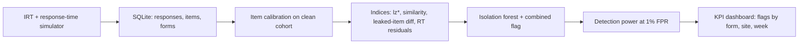

# Exam Test-Security Forensics - Detecting Answer Copying, Item Preknowledge and Response-Time Anomalies with Psychometric Statistics

`test-security-forensics` · new project · estimated build effort: 4 h

## Problem

Certification programs must detect compromised exams without false accusations. This project simulates a certification exam with an IRT model (abilities, item difficulty, response times) and injects known misconduct: answer copying between candidate pairs, preknowledge of a leaked item subset, and rapid guessing. It computes standard test-security indices (person-fit lz*, answer similarity, leaked-item score differences, response-time residuals), combines them with an isolation-forest anomaly score, reports detection power at a fixed low false-positive rate, and builds a KPI dashboard for program-level monitoring.

## Target jobs and skills

- **American Nurses Association, Inc — Data Scientist, Test Security** (`bf60257a4188`): covers 77% of the JD's weighted top skills (Statistics, Anomaly Detection, Data Visualization, SQL, Python, Hypothesis Testing)

Skills/tools this project demonstrates: Python, SQL, Statistics, Anomaly Detection, Hypothesis Testing, Simulation, Machine Learning, Model Evaluation, Data Visualization, scikit-learn

## Data

- **Dataset:** Simulated exam responses (generated by script) — n/a (simulation code in the repo)
- **License/terms:** generated locally
- **Size used:** 20,000 candidates x 150 items across 4 test forms; 3% injected misconduct of three types
- **Plan:** 2PL IRT for responses and a lognormal model for response times; misconduct labels kept only for evaluation; disjoint seeds for the calibration and evaluation cohorts.

## Architecture

## Tech stack

Python 3.11, NumPy, SciPy, pandas, scikit-learn (IsolationForest), SQLite (SQL queries for KPIs), matplotlib, pytest

## Deliverables

- simulate/ (exam generator with injected misconduct and documented parameters)
- indices/ (person-fit, similarity, preknowledge, response-time) with unit tests on hand-computed cases
- Detection report with ROC/power curves per misconduct type at 1% and 0.1% false-positive rates
- SQL KPI queries and a static HTML/PNG dashboard (flags by form, site, week)

## Success criteria (all must hold on a from-scratch `python run.py`)

| Metric | Threshold | How it is measured |
|---|---|---|
| Detection power (recall) for answer copying at 1% false-positive rate | >= 0.80 | evaluation cohort |
| Detection power for item preknowledge at 1% FPR | >= 0.60 | evaluation cohort |
| False-positive control | observed FPR on clean candidates within 0.5 points of the nominal 1% | clean subset |
| Baseline | combined model AUC at least 0.10 higher than a raw-score z-score baseline | same candidates |
| Test coverage | >= 75% | pytest --cov |

## Evaluation artifacts (required; the evaluator recomputes metrics from these)

- results/metrics.json with keys power_copy_fpr01, power_preknowledge_fpr01, power_rapidguess_fpr01, observed_fpr, auc_combined, auc_baseline
- results/candidate_scores.csv with columns candidate_id, form, lz_star, similarity_max, preknowledge_diff, rt_residual, iforest_score, combined_score, baseline_score (total-score z), flagged (combined_score above the threshold set for 1% FPR on the calibration cohort), true_label (clean | copy | preknowledge | rapid_guess); evaluation cohort only

## Baseline

Flag candidates with total-score z > 2 (score-only screening).

## Constraints

- Runs on Windows with `python run.py` from a fresh virtualenv; no make, shell scripts, paid APIs, or accounts.
- CPU-only by default (an optional `--device cuda` flag is fine); peak RAM <= 3 GB; total downloads <= 1.5 GB.
- PyTorch (if used) pinned to the CPU wheel via `--extra-index-url https://download.pytorch.org/whl/cpu`.
- Fixed random seeds; every reported number is written by code to results/metrics.json (never typed by hand).
- Test split is created once, saved, and never used for training, tuning, or threshold selection.
- Data download is scripted (Python requests), cached under data/, and verified by checksum or row count.
- All data simulated and labeled as such; no real candidate data and no claims of operational use.

## Draft resume bullets (placeholders are filled only with reproduced metrics)

- Built exam-forensics indices (person-fit, answer similarity, preknowledge, response-time anomalies) and detected simulated answer copying at [COPY_RECALL]% recall at a 1% false-positive rate
- Combined psychometric indices with an isolation forest, raising AUC from [BASE_AUC] (score-only) to [AUC] on [N] simulated candidates
- Wrote SQL KPI queries and a dashboard tracking flag rates by form, site and week
